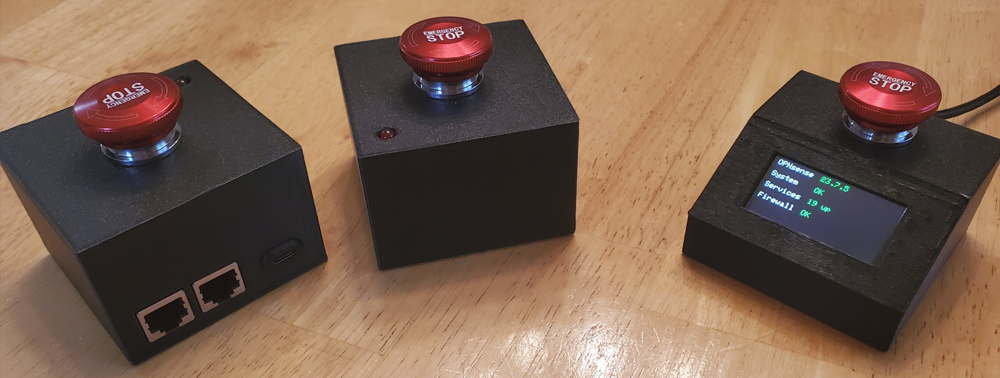

# esp32NetworkBlocker

**ESP32 Network Blocker \- Internet Kill Switch**

**v2 released Feb 18, 2026**

Wouldn't it be great to have an Emergency Stop switch for your network?   With it you could lock out your kids from the internet, shut down access for a short while and bring it back up quickly without needing to reboot anything, or cut off those foreign state actors who are hacking into your network :-)

Well, here are two separate open source DIY projects to build your own internet kill switch!

|     |     |     |     |     |
| --- | --- | --- | --- | --- |
|     | **Project 1**, show below as the box on the left and optionally the box in the middle, allows you to effectively unplug, and plug back in, the network cable between your internet provider and your firewall, switch or computer - even if that cable is some distance (typically 15 meters / 50 feet or more inside a home or building) from where you are. |     |     | **Project 2**, shown below as the box on the right, allows you to control your OPNsense firewall (assuming you have one), to enable/disable automated rules to block/unblock traffic as you see fit.  As an added bonus, you get a small remote monitor showing you near real time stats on your OPNsense software version, system, services and firewall. |

[Please click here for a short youtube video showing both projects](https://www.youtube.com/watch?v=1Lzr3zUr39w) 

|     |     |     |
| --- | --- | --- |
| **Here's what's needed and how to put the projects together** |     |     |
| **Project 1      Hardwired Control box with an optional remote switch** |     | **Project 2      A Control box for use with OPNsense** |
|     |     |     |
| **For the hardwired control box:** |     | 1 x [LilyGo T-Display-S3 (with pins soldered to the board)](https://s.click.aliexpress.com/e/_DD2nocP) |
| 1 x [ESP32 30 Pin (Devkit V1)](https://s.click.aliexpress.com/e/_DCGS8Nt) |     | 1 x [22mm Emergency Stop Button (1NO 1NC)](https://s.click.aliexpress.com/e/_DCbjZUF) |
| 1 x [22mm Emergency Stop Button (1NO 1NC)](https://s.click.aliexpress.com/e/_c4rGnndz) |     | 1 x USB power source |
| 1 x [3v DPDT Relay](https://www.digikey.ca/en/products/detail/cit-relay-and-switch/J104D2C3VDC-15S/12502634) |     | 1 x USB power cable |
| 2 x [RJ45 Connector Jacks](https://s.click.aliexpress.com/e/_c3Cac0sB) |     | (optional) 1 x external LED + matching resistor |
| 1 x  [7 screw terminal block pins](https://s.click.aliexpress.com/e/_c3EAFCon) |     | (optional) 1 x [Type C jack power connector](https://s.click.aliexpress.com/e/_c38Qvydv) |
| 2 x [Female header pins row of 15](https://s.click.aliexpress.com/e/_DeSg9p9) |     |     |
| 1 x USB power source |     | [this open source code from Github](https://github.com/roblatour/esp32NetworkBlocker/tree/main/ArduinoCode/esp32NetworkBlockerForOPNsense) |
| 1 x USB power cable |     |     |
| (optional) 1 x external LED + matching resistor |     | a Firewall running [OPNsense](https://opnsense.org/) to which you have admin access |
| (optional) 1 x [Type C jack power connector](https://s.click.aliexpress.com/e/_c3AlUMht) |     |     |
|     |     | some form of case/enclosure; [here are the open source 3D printable files designed specifically for the projects above](https://www.printables.com/model/609103) |
| **To add an optional remote switch:** |     |     |
| +1 x ESP32 Devkit V1 (30) pin |     | [Arduino IDE](https://www.arduino.cc/en/software) |
| +1 x Emergency Stop Button |     |     |
| 1 x USB power source |     | wires (for connecting terminals),   heat shrink tubing or electrical tape, a soldering iron, solder and flux |
| 1 x USB power cable |     |     |
| 1 x 7 screw terminal block pins |     | **Setup:** |
| 2 x Female header pins row of 15 |     | First,  you will need to setup rules within OPNsense to block traffic as you see fit.  This is done via the OPNsense - Firewall - Automation - Filter window.       On my system I have two interfaces for which I want access blocked, these are LAN and LAN\_IOT.  For this  added two rules, one like [this rule](images/rule1.jpg) to block all IPv4 traffic, and another like [this rule](images/rule2.jpg) to block all IPv6 traffic.  Of note, when setup these rules should be normally disabled.      Next download the Arduino sketch and associated settings files (linked to above).       After that the secret\_settings.h file will need to be updated; instructions within the file tell you how to get at the needed information.      Next, build and upload the Arduino sketch to your Lilygo T-Display S3.      Then physically connect the hardware (switch and power supply) as identified in the sketch.      Finally, test and if everything is working as expected add the project into a case. |
| (optional) +1 external LED + matching resistor |     |
| (optional) +1 x Type C jack power connector |     |
|     |     |
| [This open source code from Github](https://github.com/roblatour/esp32NetworkBlocker/tree/main/ArduinoCode/esp32NetworkBlocker) |     |
|     |     |
| (Optionally) [this PCB](https://oshwlab.com/roblatour/networkblockerv1) |     |
|     |     |
| [Arduino IDE](https://www.arduino.cc/en/software) |     |
|     |     |
| some form of case/enclosure; [here are the open source 3D printable files designed specifically for the projects above](https://www.printables.com/model/609086) |     |
|     |     |
| wires (use 22 gauge for connecting RJ45 terminals),   heat shrink tubing or electrical tape, a soldering iron, solder and flux |     |
|     |     |
| **Setup:**      The Control box with an Emergency Stop button can be setup as a standalone device, or you can set up both the Control box and Switch box (each with their own Emergency Stop buttons) to work in harmony.       In the first case, if the Emergency Stop button is pressed down on the Control box then network blocking will be activated.  In the second case if the Emergency Stop button is pressed down on either the Control box or the Switch box then network blocking will be activated.      The Arduino sketch (linked to above) runs on both the Control box and the Switch box.  If you follow the recommended pin wiring in the sketch the program will, at runtime, determine if the device is the controller box or the remote switch box.      The Control box and the Switch box communicate using ESP-NOW.   ESP-NOW does not rely on your home/business Wi-Fi network, rather the wireless communication are set up directly between the two ESP32 devices.  Using ESP-NOW the maximum distance between the Control box and the Switch box will depend on the configuration of your home/building and where within it the two boxes are set up.  In my case, the Control box in the basement works fine with the Switch box on the first floor.  Your millage may vary.      The sketch will also automatically assign the needed MAC addresses for the Control box and the Switch box - so no need to change the sketch for the MAC addresses of either the Control box or the Switch box.      There are however some setting near the top of the sketch that you may change if you like.  The most important one is to indicate if you are going to be using a remote switch box or not.  The others you can change at your option.      Also, the sketch indicates which ESP32 pins are connected to which other hardware components (the relay, LEDs, power supply).      The PCB linked to above makes it easy.      This setup has been tested this with a 1.5 GB internet service and in no way lessened the bandwidth throughput (in or out).      If you are not using the PCB linked to above, the relay is used to interrupt the orange wire and the green wire of the wires between the two RJ45 connectors.  All other wires are just connected like for like on the RJ45 connectors.      Beyond that, just download the sketch (linked to above), update the settings if you like, build and upload it to your ESP32 DevKit v1 board(s) and physically connect the other hardware as needed.      Finally, test and if everything is working as expected add the project into a case. |     |
|     |     |     |

* * *
 ## Support esp32NetworkBlocker

 To help support esp32NetworkBlocker, or to just say thanks, you're welcome to 'buy me a coffee'  

* * *
Copyright © 2026 Rob Latour
* * *   
